# MAINTiDOC — Assistant documentaire multimodal et agentique

Assistant documentaire local pour la maintenance : questions sur des manuels PDF, réponses avec références aux pages, recherche de figures à partir d'une photo et consultation d'un registre de garanties fictif.

L'architecture cible fournie pour MAINTiDOC s'adresse aux **techniciens et responsables de maintenance**. Elle prévoit une interface Web et des bots de messagerie, une API sécurisée, un RAG multimodal, un superviseur LangGraph et des outils MCP permettant de préparer des tickets soumis à validation humaine. Le dépôt contient actuellement le socle documentaire et un premier parcours agentique ; les composants restant à construire sont identifiés ci-dessous.

Cette version reprend les fonctionnalités déjà réalisées dans [Agentic-AI-MCP](https://github.com/dounia1230/Agentic-AI-MCP/tree/48781917a48a68ad1b34dc72036e5178f2e63b8b), avec **BGE-M3 à la place de Nomic** et **Qdrant à la place de PGVector**. Elle conserve LangChain, LangGraph, MCP, LlamaIndex/PyMuPDF, le VLM local et Streamlit.

## Fonctionnalités actuelles

- Importer des manuels PDF et extraire leur texte, leurs tableaux et leurs figures.
- Poser une question technique et recevoir une réponse accompagnée des fichiers et pages consultés.
- Décrire les figures des manuels avec un VLM local et les retrouver à partir d'une photo avec CLIP.
- Orienter les demandes vers un agent documentaire ou un agent de garantie avec LangGraph.
- Consulter un registre de garanties fictif, en lecture seule.
- Piloter l'indexation et les questions documentaires via un serveur MCP Streamable HTTP.

## Architecture cible

Le diagramme reprend les couches du schéma MAINTiDOC fourni. **Vert : composant présent ; bleu : composant partiel ou différent de la cible ; orange pointillé : composant prévu.** Un composant présent ne signifie pas que tous les critères de validation du projet sont acquis. Le tableau après le diagramme précise les écarts avec le code actuel.

```mermaid
flowchart TD
    Utilisateurs["Techniciens et responsables de maintenance"]

    subgraph Clients["Clients utilisateurs"]
        Web["Interface Web Streamlit"]
        Telegram["Bot Telegram"]
        Discord["Bot Discord"]
    end

    subgraph Securite["Couche API et sécurité"]
        Auth["Authentification et autorisation<br/>JWT / OAuth, rôles et permissions"]
        API["API REST FastAPI<br/>Questions, uploads et validation humaine"]
        Sessions["Utilisateurs et sessions<br/>Comptes liés, historique, tokens d'approbation"]
        Traces["Observabilité et traçabilité<br/>Requêtes, outils et tickets"]
    end

    subgraph Ingestion["Ingestion et gestion du corpus"]
        Sources["PDF, images et manuels"]
        Extraction["PyMuPDF et OCR<br/>Texte, figures et tableaux"]
        Decoupage["Découpage et enrichissement<br/>Page, équipement, version et droits"]
        Embeddings["Embeddings textuels BGE-M3<br/>et visuels CLIP"]
        Sources --> Extraction --> Decoupage --> Embeddings
    end

    subgraph Orchestration["Orchestration agentique LangGraph"]
        Conversation["Gestion de la conversation"]
        Superviseur["Superviseur et planificateur<br/>Analyse, étapes, appels d'outils et clarifications"]
        Verification["Vérification et structuration<br/>Références, Pydantic et incertitudes"]
        Sortie["Réponse sourcée, clarification<br/>ou brouillon de ticket"]
        Approbation["Approbation humaine explicite<br/>Liée au contenu exact et à l'utilisateur"]
        Conversation --> Superviseur
        Superviseur --> Verification --> Sortie
        Sortie -->|Brouillon de ticket| Approbation
    end

    subgraph RAG["RAG multimodal"]
        RechercheTexte["Recherche textuelle<br/>BGE-M3, BM25 et filtres de permissions"]
        RechercheVisuelle["Recherche texte-image<br/>CLIP multilingue, figures et schémas"]
        Fusion["Fusion Reciprocal Rank Fusion<br/>et reranker multilingue adapté"]
        RechercheTexte --> Fusion
        RechercheVisuelle --> Fusion
    end

    subgraph Vision["Modèle vision-langage à poids ouverts"]
        VLM["Cible : Qwen2.5-VL-7B-Instruct<br/>Analyse d'images et génération multimodale"]
    end

    subgraph Maintenance["Outils MCP de maintenance"]
        ClientMCP["Client MCP dans LangGraph"]
        ServeurMCP["Serveur MCP<br/>Historique et tickets ouverts<br/>Création de ticket après approbation"]
        ClientMCP <--> ServeurMCP
    end

    subgraph Stockage["Stockage et bases de données"]
        Qdrant[("Qdrant<br/>Vecteurs textuels et visuels")]
        PostgreSQL[("PostgreSQL<br/>Métadonnées, utilisateurs,<br/>permissions, conversations et tickets")]
        MinIO[("MinIO<br/>Documents, images et figures")]
        Modeles["Stockage et cache des modèles<br/>Poids VLM et reranker, Hugging Face"]
    end

    subgraph Exploitation["Suivi, évaluation et déploiement"]
        MLflow["MLflow<br/>Expériences, versions, nDCG et MRR"]
        Docker["Docker Compose<br/>Services et environnements reproductibles"]
        Monitoring["Monitoring et logs<br/>Prometheus / Grafana, latence et GPU"]
    end

    Utilisateurs --> Web & Telegram & Discord
    Web & Telegram & Discord --> Auth
    Auth --> API
    API <--> Sessions
    API --> Traces
    API -->|Documents| Sources
    API --> Conversation
    Approbation -->|Reprise approuvée| API
    Sortie -->|Réponse au client| API
    Superviseur <--> Fusion
    Superviseur <--> VLM
    Superviseur <--> ClientMCP
    Embeddings --> Qdrant
    RechercheTexte <--> Qdrant
    RechercheVisuelle <--> Qdrant
    Sources --> MinIO
    Decoupage --> PostgreSQL
    Sessions <--> PostgreSQL
    ServeurMCP <--> PostgreSQL
    ServeurMCP -.-> Traces
    Modeles --> VLM & Fusion
    Fusion -.-> MLflow
    Traces --> Monitoring
    Docker -.-> API & Qdrant & ServeurMCP

    classDef present fill:#E7F4EA,stroke:#2E7D32,color:#12351B
    classDef partiel fill:#E3F2FD,stroke:#1976D2,color:#12304A
    classDef prevu fill:#FFF3E0,stroke:#B26A00,stroke-dasharray:5 5,color:#513300
    class Sources,Embeddings,Qdrant present
    class Web,Extraction,Decoupage,Superviseur,Sortie,RechercheTexte,RechercheVisuelle,VLM,ClientMCP,ServeurMCP,Docker partiel
    class Telegram,Discord,Auth,API,Sessions,Traces,Conversation,Verification,Approbation,Fusion,PostgreSQL,MinIO,Modeles,MLflow,Monitoring prevu
```



### Correspondance avec l'implémentation actuelle

| Couche du schéma | Présent dans le dépôt | Évolution prévue |
| --- | --- | --- |
| Clients | Streamlit pour les questions, photos et imports ; client terminal | Bot Telegram ou Discord, consultation de l'historique de maintenance et validation des tickets |
| API et sécurité | Validation locale des fichiers importés | FastAPI, authentification JWT/OAuth ou comptes locaux, rôles, permissions, comptes de messagerie associés et tokens d'approbation |
| Ingestion | PyMuPDF/LlamaIndex, texte, tableaux, figures, pages et versions | OCR local pour les PDF scannés, métadonnées d'équipement et droits d'accès |
| Orchestration | Routage LangGraph vers un agent documentaire ou de garantie | Gestion de conversation, planification, clarifications et interruption/reprise pour approbation humaine |
| Vérification | Références documentaires conservées ; Pydantic utilisé pour le routage | Validation structurée des réponses, contrôle des références, incertitudes et demandes de clarification |
| RAG multimodal | BGE-M3, BM25 français, Qdrant, descriptions VLM et similarité image-image CLIP | CLIP texte-image multilingue, filtres de permissions, fusion RRF et reranker adapté |
| VLM | `qwen3.5:4b` via Ollama, pour décrire les figures pendant l'ingestion et générer les réponses textuelles | `Qwen2.5-VL-7B-Instruct` dans le schéma cible, avec analyse des photos dans le parcours de question |
| MCP | Client et serveur documentaires avec `indexer_manuels` et `rag_multimodal` | Service de maintenance avec historique, tickets ouverts et création soumise à approbation |
| Stockage | Qdrant pour les vecteurs et métadonnées ; fichiers et registre fictif en local ; caches de modèles locaux | PostgreSQL pour les données applicatives, MinIO pour les fichiers et versionnement des modèles |
| Évaluation et exploitation | Tests automatisés, dépendances verrouillées et Compose pour Qdrant | MLflow, conteneurisation complète, traces centralisées, Prometheus/Grafana et mesures de latence/ressources |

Le chemin exécuté aujourd'hui reste **Streamlit ou terminal → orchestrateur LangGraph → agent spécialisé → orchestrateur → fin**. L'agent documentaire utilise le client MCP puis le RAG ; l'agent de garantie consulte un registre JSON local en lecture seule. Chaque question démarre un nouvel état, sans mémoire conversationnelle transmise aux agents.

### Modèles et fine-tuning

| Modèle | Rôle dans l'architecture | Adaptation demandée |
| --- | --- | --- |
| BGE-M3 | Embeddings textuels pour la recherche documentaire | Utilisation du modèle préentraîné |
| CLIP multilingue | Recherche texte-image et indexation visuelle dans la cible | Intégration de l'encodeur ; la version actuelle effectue une recherche image-image avec CLIP ViT-B-32 |
| Reranker multilingue | Reclasser les passages retrouvés avant la génération | **Fine-tuning ciblé**, modèle exact à choisir |
| Qwen2.5-VL-7B-Instruct | Analyse d'images et génération multimodale dans la cible | Intégration du VLM à poids ouverts ; aucun fine-tuning du VLM n'est imposé par la feuille de route |

Le fine-tuning prévu porte sur le **reranker multilingue**. La feuille de route demande **800 à 1 500 exemples vérifiés**, puis une comparaison **sans reranker / avec reranker initial / avec reranker adapté**, mesurée avec **nDCG@5 et MRR@10**. Le reranker adapté doit être versionné ; MLflow est prévu dans l'architecture pour suivre ces expériences. BGE-M3 et le VLM remplissent des rôles distincts de ce classement.

### Workflow de maintenance prévu

Le superviseur doit consulter `get_equipment_history(equipment_id)` et `get_open_tickets(equipment_id)`, puis proposer un brouillon si un ticket est nécessaire. Le workflow s'interrompt pour une approbation humaine explicite. Le serveur vérifie les permissions et un token associé au contenu exact et à l'utilisateur avant d'accepter `create_ticket(equipment_id, title, description, approval_token)`. L'idempotence doit empêcher les créations en double, et une annulation doit abandonner l'action en attente. Ces outils de maintenance restent à implémenter.

### Rôle des stockages dans la cible

**Qdrant** conserve les index vectoriels textuels et visuels. **PostgreSQL** est prévu pour les métadonnées métier, les utilisateurs, les permissions, les conversations et les informations de tickets ; il n'a pas vocation à remplacer Qdrant par PGVector. **MinIO** doit conserver les documents originaux, images et figures. Les poids du VLM et du reranker doivent être stockés et versionnés séparément, avec un cache d'inférence. Pour le prototype actuel, les métadonnées documentaires restent dans Qdrant et les fichiers sur le disque local.

### RAG textuel et visuel

Le pipeline découpe le texte en passages d'environ 256 mots, avec un recouvrement de 32 mots. Les métadonnées conservent le fichier, la page, le type de contenu et la version d'ingestion. Les tableaux sont conservés sous forme de lignes et colonnes, puis indexés en Markdown.

Dans le prototype actuel, le VLM décrit les figures des manuels à partir de leurs pixels. Le texte, les tableaux et ces descriptions sont encodés avec **BGE-M3**, sans préfixes de requête. Cette version utilise ses embeddings denses ; la recherche lexicale BM25 est calculée séparément. Les figures reçoivent aussi des embeddings **CLIP**, dans un espace visuel distinct. La fusion RRF et le reranker du schéma cible ne sont pas encore implémentés.

Lors d'une question, la recherche combine BM25 français et similarité BGE-M3. Si une photo est fournie, CLIP retrouve les figures visuellement proches. La photo de l'utilisateur n'est pas directement décrite par le VLM dans ce parcours. La génération s'appuie sur les passages et descriptions retrouvés ; l'interface affiche les références et jusqu'à deux figures ou aperçus de pages.

### Collections et versions

| Collection Qdrant | Contenu |
| --- | --- |
| `maintidoc_passages_<clé>` | Passages, tableaux et descriptions, vecteurs BGE-M3 de dimension 1024 |
| `maintidoc_figures_<clé>` | Figures et vecteurs CLIP de dimension 512 |
| `maintidoc_index_actif` | Version publiée et configuration des modèles |

La clé dépend de la configuration des modèles et du pipeline. Le payload des passages et figures contient `text` et `metadata`. Les identifiants de points sont dérivés des identifiants LlamaIndex ; rejouer un ajout ne duplique pas ces points.

Une nouvelle ingestion prépare les deux collections avant de publier leur version commune dans un unique point Qdrant. Les recherches filtrent sur cette version. Un échec de calcul conserve la version publiée précédente ; une interruption peut laisser des points inactifs. Il ne s'agit pas d'une transaction entre collections. Les anciennes versions sont supprimées après publication.

Le serveur MCP sérialise les recherches et l'indexation avec un verrou. Utiliser un seul serveur MCP par préfixe Qdrant et éviter une ingestion CLI simultanée. Les poids des modèles ne sont pas inclus dans le dépôt ; modifier un modèle, même sous le même tag Ollama, exige une nouvelle ingestion.

## Organisation du code

| Fichier | Responsabilité |
| --- | --- |
| `config.py` | Modèles Ollama, BGE-M3, adresses des services et chemins locaux |
| `ingestion.py` | Extraction PDF, tableaux, figures et construction des index |
| `stockage.py` | Collections Qdrant, filtres, recherche vectorielle et publication des versions |
| `vision.py` | Descriptions VLM, cache des descriptions et embeddings CLIP |
| `recherche.py` | Recherche BM25/vectorielle et sélection des figures |
| `rag.py` | Recherche documentaire et génération de réponses sourcées |
| `mcp_server.py` | Outils documentaires exposés en MCP |
| `agents.py` / `orchestrateur.py` | Agents spécialisés et graphe LangGraph |
| `app.py` / `main.py` | Interface Streamlit et client terminal |
| `fichiers.py` | Validation des imports, appels d'indexation et affichage des sources |
| `garantie.py` / `data/garanties.json` | Consultation du registre de garanties fictif |
| `tests/` | Tests applicatifs, stockage Qdrant et intégration avec modèles réels |

## Installation du prototype actuel

Les commandes ci-dessous correspondent au code exécutable de ce dépôt : BGE-M3 et Qwen3.5 via Ollama, Qdrant et Streamlit. Le diagramme cible ne nécessite pas d'installer dès maintenant les composants encore prévus, notamment PostgreSQL, MinIO, MLflow et les bots.

Prérequis : Python 3.11+, [uv](https://docs.astral.sh/uv/), [Ollama](https://ollama.com/) et Docker avec Compose. Exécuter les commandes depuis la racine du dépôt.

```powershell
uv sync --locked
if (-not (Test-Path .env)) { Copy-Item .env.example .env }
docker compose up -d qdrant
ollama pull bge-m3
ollama pull qwen3.5:4b
```

Si `.env` existe, le conserver et ajouter les variables manquantes depuis `.env.example`. Qdrant stocke ses données dans un volume Docker persistant ; aucune base PostgreSQL n'est nécessaire. Docker Compose démarre uniquement Qdrant. Ollama, MCP et Streamlit s'exécutent sur la machine hôte.

Le modèle CLIP télécharge ses poids au premier usage si absents. Le VLM et BGE-M3 tournent via Ollama ; démarrer `ollama serve` si Ollama n'est pas déjà actif.

| Variable | Valeur par défaut / usage |
| --- | --- |
| `OLLAMA_URL` | `http://localhost:11434` |
| `CHAT_MODEL` | `qwen3.5:4b` pour le routage et les réponses |
| `VISION_MODEL` | `qwen3.5:4b` pour décrire les figures des manuels |
| `EMBEDDING_MODEL` | `bge-m3`, embeddings textuels denses |
| `EMBEDDING_DIM` | `1024`, dimension attendue dans Qdrant |
| `CLIP_MODEL` / `CLIP_CHECKPOINT` | `ViT-B-32` / `openai`, vecteurs visuels 512 |
| `QDRANT_URL` | `http://127.0.0.1:6333` |
| `QDRANT_API_KEY` | Vide pour le serveur local ; facultative pour un serveur configuré |
| `QDRANT_PREFIX` | `maintidoc`, espace de noms des collections |
| `MCP_URL` | `http://127.0.0.1:24001/mcp` |

Le modèle de chat doit prendre en charge les outils et les sorties JSON. Le modèle de vision doit accepter les images. Tout changement de modèle ou de dimension exige une nouvelle ingestion. Les dépendances Python exactes sont conservées dans `uv.lock`.

## Démarrer l'application

Premier terminal :

```powershell
uv run mcp_server.py
```

Second terminal :

```powershell
uv run streamlit run app.py
```

Ouvrir **http://127.0.0.1:8503**. Le tableau de bord Qdrant est disponible sur http://127.0.0.1:6333/dashboard. Les ports MCP `24001` et Streamlit `8503` distinguent MAINTiDOC de l'application source.

1. Importer un PDF dans la barre latérale, puis cliquer sur **Importer le fichier**.
2. Cliquer sur **Indexer les PDF** et attendre la confirmation.
3. Poser une question technique en précisant l'équipement.
4. Pour une recherche par photo, importer une image puis la sélectionner avant la question.

Les fichiers acceptés sont PDF, PNG, JPEG et WebP, jusqu'à 50 Mo. Les manuels peuvent aussi être placés dans `data/manuels/` et les photos dans `data/photos/`. Ces données restent locales et sont exclues de Git.

L'indexation extrait texte, tableaux et figures, décrit les figures avec le VLM, puis calcule BGE-M3 et CLIP dans deux collections Qdrant distinctes. Les descriptions visuelles sont mises en cache. La première ingestion d'un long manuel peut prendre du temps. Une nouvelle version n'est publiée qu'après la réussite des deux index ; un échec de calcul conserve la version précédente.

Exemples de questions, selon les documents importés :

- « Comment retirer un bourrage papier sur mon Epson ET-2850 ? Cite les pages utilisées. »
- « Quelle capacité de chargement figure dans le tableau du manuel ? »
- « Retrouve les figures proches de cette photo. »
- « Mon appareil PX200-0042 est-il sous garantie ? »

Chaque question est indépendante. Le registre de garantie est fictif et consulté en lecture seule. Les images affichées proviennent des manuels ; une ressemblance visuelle ne suffit pas à établir un diagnostic.

## Utilisation en terminal

```powershell
uv run ingestion.py
uv run main.py "Comment retirer un bourrage papier sur mon Epson ET-2850 ?"
uv run main.py "À quelle figure ressemble mon appareil ?" --photo nom_de_la_photo
uv run garantie.py PX200-0042
```

`--photo` désigne un fichier dans `data/photos/`, avec ou sans extension. L'ingestion et les questions documentaires nécessitent Qdrant et Ollama. Ne pas exécuter plusieurs ingestions ou plusieurs serveurs MCP simultanément sur le même préfixe Qdrant.

## Vérification et dépannage

```powershell
uv run pytest -q
uv run ruff check .
uv run ruff format --check .
```

Les tests courants n'appellent pas Ollama. Ils utilisent de petits PDF réels, des modèles simulés et le moteur local Qdrant réel en mémoire et sur disque. Ils couvrent l'extraction, les sources, l'interface, le routage, le transport MCP, les filtres Qdrant, la pagination, les dimensions, la persistance et les versions publiées.

Pour vérifier aussi le serveur HTTP Qdrant :

```powershell
docker compose up -d qdrant
$env:RUN_QDRANT_TESTS = "1"
uv run pytest -q tests/test_stockage.py
Remove-Item Env:RUN_QDRANT_TESTS
```

Pour exécuter le parcours avec les vrais modèles, préparer Ollama, BGE-M3, Qwen3.5 et Qdrant, puis lancer :

```powershell
$env:RUN_MODEL_TESTS = "1"
uv run pytest -q -s tests/test_integration.py
Remove-Item Env:RUN_MODEL_TESTS
```

Cet essai crée un PDF et une photo temporaires, lance MCP sur un port libre, puis traverse réellement BGE-M3, le VLM, CLIP, Qdrant et LangGraph. Il vérifie la réponse et les références attendues. Les processus et collections propres au test sont nettoyés à la fin ; les services Ollama et Qdrant doivent déjà fonctionner.

Résultats observés le 26 novembre 2026 : **66 tests courants réussis**, **16 tests de stockage réussis** avec les modes mémoire, disque et HTTP, et **1 test d'intégration avec modèles réels réussi**. Ces suites se recouvrent ; leurs nombres ne s'additionnent pas. Le test réel a répondu sur le code E02 avec une référence à `manuel_smoke.pdf, page 1`. Ces essais sur une petite fixture ne remplacent pas une évaluation sur un corpus représentatif.

### Dépannage

- **Qdrant inaccessible** : vérifier `docker compose ps`, `docker compose logs qdrant` et `QDRANT_URL`.
- **Modèle absent** : vérifier `ollama list` puis télécharger le modèle configuré avec `ollama pull`.
- **Dimension incompatible** : BGE-M3 attend 1024 dimensions ; vérifier `.env` et réindexer. Les anciens vecteurs Nomic/PGVector ne sont pas réutilisables.
- **MCP inaccessible** : lancer `uv run mcp_server.py` et vérifier `MCP_URL`.
- **Indexation longue** : suivre le terminal MCP ; un second clic attend le même traitement. En cas d'échec, un nouveau clic peut réessayer.

Pour arrêter Qdrant sans supprimer ses données : `docker compose stop qdrant`.

## État du projet

Les étapes ci-dessous reprennent la feuille de route pédagogique. Les tests techniques ne suffisent pas à valider tous les critères de chaque étape.

| Étape | Réalisé | À compléter |
| --- | --- | --- |
| 1 — RAG documentaire | Extraction, découpage, métadonnées, BGE-M3, Qdrant, LangChain et Streamlit | Corpus autorisé de 30 à 50 documents sur deux familles, FastAPI, permissions documentaires, OCR si nécessaire et validation du corpus |
| 2 — Multimodalité et fine-tuning | Figures décrites par VLM, tableaux, schémas et recherche par photo CLIP | Recherche texte-image multilingue, reranker et adaptation sur 800 à 1 500 exemples vérifiés, comparaison nDCG@5/MRR@10 et réponses Pydantic avec incertitudes/clarifications |
| 3 — Agentique et MCP | Routage LangGraph, client/serveur MCP documentaire et agent garantie | Historique de maintenance, tickets ouverts, brouillons, création après approbation liée au contenu et à l'utilisateur, autorisations et idempotence |
| 4 — Intégration et déploiement | Client Streamlit, dépendances verrouillées, Compose pour Qdrant et tests applicatifs | Bot Telegram/Discord, identités, PostgreSQL/MinIO, MLflow, monitoring, conteneurisation complète, tests d'injection/accès/approbation, environ 150 scénarios, mesures et démonstration finale |

Le registre de garanties fictif est un complément ; il ne remplace pas l'historique de maintenance demandé.

## Limites

Chaque question démarre un nouvel état : l'historique affiché par Streamlit n'est pas une mémoire conversationnelle. L'OCR des PDF scannés et la reconstruction des tableaux sans bordures ne sont pas implémentés.

Les fichiers importés sont validés et confinés aux répertoires locaux. Les extraits et les images sont traités comme des données non fiables dans les prompts ; la résistance aux injections reste à évaluer. Les identités applicatives, droits documentaires par utilisateur, tickets et approbations humaines ne sont pas encore implémentés. `.env`, les documents importés et les données Qdrant restent exclus de Git.

Les descriptions visuelles peuvent être imprécises et une ressemblance ne suffit pas à établir un diagnostic. Le système ne pilote aucun équipement et ne remplace pas un technicien habilité.

## Références

- [Projet source Agentic-AI-MCP, commit 4878191](https://github.com/dounia1230/Agentic-AI-MCP/tree/48781917a48a68ad1b34dc72036e5178f2e63b8b)
- [BGE-M3 — BAAI](https://huggingface.co/BAAI/bge-m3)
- [BGE-M3 dans Ollama](https://ollama.com/library/bge-m3)
- [Documentation Qdrant](https://qdrant.tech/documentation/quickstart/)
